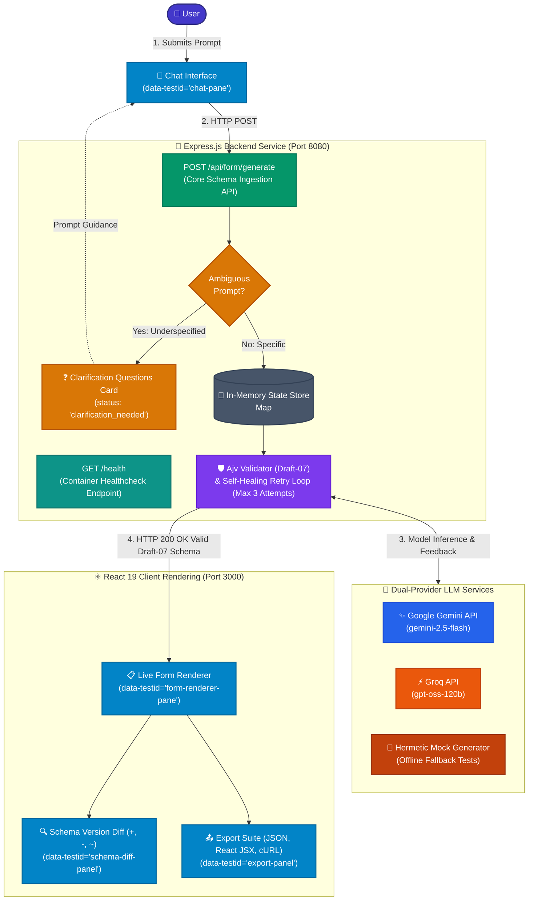
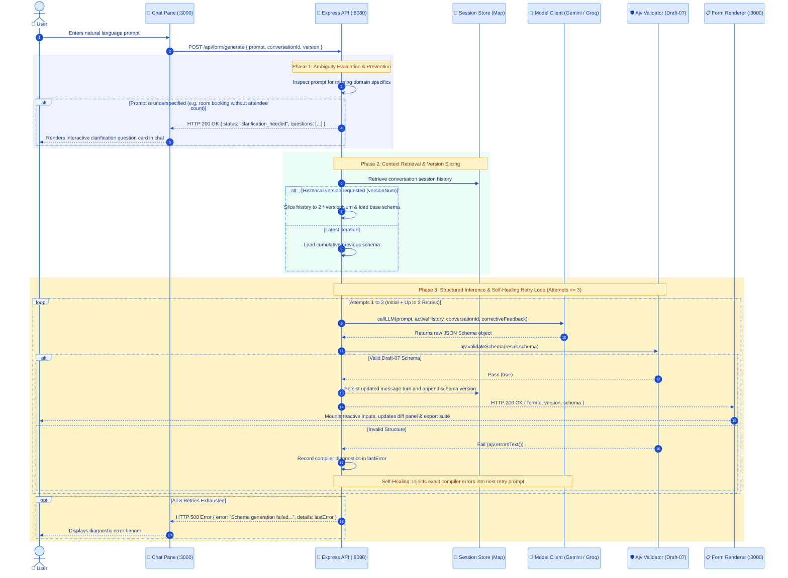
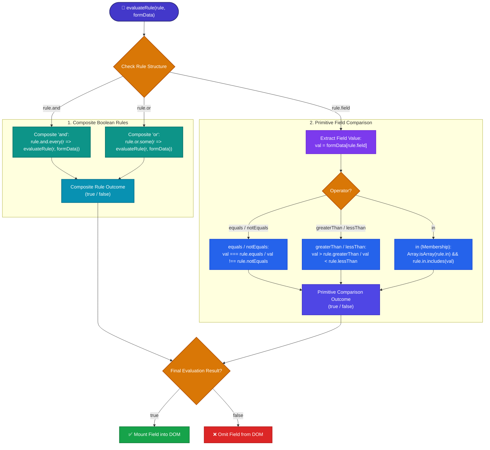

# AI-Powered Conversational Form Builder with JSON Schema

<div align="center">

[](https://react.dev/)
[](https://www.typescriptlang.org/)
[](https://nodejs.org/)
[](https://expressjs.com/)
[](https://docs.docker.com/compose/)
[](https://json-schema.org/)
[](https://ajv.js.org/)
[](https://ai.google.dev/)
[](https://groq.com/)
[](LICENSE)

<p align="center">
  A full-stack application featuring a conversational AI agent that generates and refines complex web forms based on natural language prompts, enforcing strict JSON Schema (Draft-07) contracts.
</p>

</div>

---

## 🌟 Features

- 💬 **Multi-Turn Conversational Refinement**: Refine and extend existing form schemas across multiple user prompts with automatic turn-slicing and versioning.
- 📐 **JSON Schema (Draft-07) Standard**: Ensures structured, validated data contracts for dynamic form rendering and portable cross-platform export.
- ⚡ **Real-time Live Form Renderer**: Dynamically renders inputs, range sliders, radio buttons, dropdown selects, textareas, checkboxes, and required states as schemas update.
- 🔀 **Conditional Field Visibility (`x-show-when`)**: Evaluates primitive comparisons (`equals`, `notEquals`, `greaterThan`, `lessThan`, `in`) and composite boolean rules (`and`, `or`) in real time.
- 🔍 **Visual Version Diffing**: Highlights property additions (`+`), removals (`-`), and modifications (`~`) between schema versions in a dedicated diff panel.
- 🛠️ **Clarification Detection & Interactive Inline Q&A**: Detects ambiguous prompts and renders dedicated inline input fields for each question directly within the chat message. Users can answer questions inline and click "Build Form with Answers" to synthesize specifications and generate schemas in one step.
- 🔄 **Server-Side Validation & Self-Healing Retry Engine**: Validates all generated schemas with Ajv and injects compiler diagnostics back into the prompt for up to 2 retries upon validation failure.
- 📦 **One-Command Containerization**: Docker Compose orchestration coordinating backend health checks (`GET /health`) and frontend service dependencies (`service_healthy`).
- 📤 **Export Suite**: One-click export for raw JSON Schema files, self-contained React JSX form components, and reproducible cURL API commands.

---

## 🏗️ Architecture & Technology Stack



### Technology Breakdown

- **Frontend**: React 19, TypeScript 5, Vite, Lucide Icons, Custom Responsive CSS Design System.
- **Backend**: Node.js 18, Express 4.18, Ajv 8.12 (`ajv-formats`), `@google/generative-ai`, `uuid`.
- **Validation**: JSON Schema Draft-07 meta-schema validation via server-side Ajv.
- **Containerization**: Docker & Docker Compose (`backend` with healthcheck on `GET /health` and `frontend` with `depends_on: { backend: { condition: service_healthy } }`).

---

## 🔄 Request Lifecycle & Self-Healing Pipeline



---

## 🔀 Conditional Field Visibility (`x-show-when`)

The live form renderer implements a recursive expression evaluation engine for the custom `x-show-when` JSON Schema extension property:



### Schema Examples

#### 1. Primitive Condition
```json
{
  "sendNewsletter": {
    "type": "boolean",
    "title": "Subscribe to newsletter?"
  },
  "emailFrequency": {
    "type": "string",
    "title": "Email Frequency",
    "enum": ["Daily", "Weekly", "Monthly"],
    "x-show-when": {
      "field": "sendNewsletter",
      "equals": true
    }
  }
}
```

#### 2. Composite Nested Condition (`and` / `or`)
```json
{
  "complianceAuditTier": {
    "type": "string",
    "title": "Compliance Audit Tier",
    "enum": ["Tier 1 (Standard)", "Tier 2 (Enhanced)"],
    "x-show-when": {
      "and": [
        { "field": "requiresAudit", "equals": true },
        { "field": "employeeCount", "greaterThan": 25 }
      ]
    }
  }
}
```

---

## ⚙️ Key Design Decisions

- **JSON Schema Draft-07 as the Universal Contract**
  - *Decision*: Enforce JSON Schema Draft-07 meta-schema validation on all model responses rather than code-first validators like Zod or Yup.
  - *Rationale*: JSON Schema is declarative, language-agnostic data that can be exported, validated on any backend (Node, Python, Go), and directly parsed into UI components or OpenAPI specifications without runtime JavaScript coupling.
  - *Implementation*: `ajv.validateSchema(result.schema)` validates the schema structure server-side before persisting or sending to the frontend.
  - *Trade-offs*: Requires declarative custom extensions (`x-show-when`) for client-side conditional logic instead of arbitrary JavaScript expressions.

- **Self-Healing Feedback Retries over Blind Retries**
  - *Decision*: Inject compiler error diagnostics directly into model prompts during validation retries.
  - *Rationale*: Blind retries assume random variance will fix schema bugs. Injecting the exact compiler failure path guides the model directly to the syntax violation.
  - *Implementation*: Validation errors captured via `ajv.errorsText()` are appended to `lastError` and passed to subsequent `callLLM` attempts as user-level corrective feedback.
  - *Trade-offs*: Slightly increases input token usage on subsequent retry attempts.

- **Dual-Provider LLM Routing with Automatic Cascade**
  - *Decision*: Provide runtime model selection between Google Gemini (`gemini-2.5-flash`) and Groq (`openai/gpt-oss-120b`, `openai/gpt-oss-20b`) with a local hermetic fallback generator.
  - *Rationale*: Prevents single-vendor vendor lock-in, shields against model rate limits or quota spikes, and guarantees that local and offline test suites execute without API keys.
  - *Implementation*: Detects API key prefix (`gsk_` for Groq, others for Gemini `gemini-2.5-flash`), featuring automatic failover to Groq upon API rate limits, and fallback to `generateMockSchema` when unset.
  - *Trade-offs*: System prompts must adhere to shared instruction standards compatible with Gemini and Groq JSON-mode contracts.

- **In-Memory Multi-Turn History with Turn Slicing**
  - *Decision*: Maintain conversation state in an in-memory `Map` with dynamic history slicing when historical versions are requested.
  - *Rationale*: Delivers sub-millisecond turn updates during evaluation without external database latency or migration overhead.
  - *Implementation*: Passing `version` slices the stored messages array via `messages.slice(0, 2 * versionNum)` and loads `baseSchema = schemas[versionNum - 1]`.
  - *Trade-offs*: Active conversations reset upon backend process restarts; production horizontal scaling requires an external store like Redis.

---

## 🚀 Quick Start (One-Command Startup)

### Prerequisites

- [Docker Desktop](https://www.docker.com/products/docker-desktop) installed and running.
- [Node.js 18+](https://nodejs.org/) *(optional, only for running locally outside Docker)*.

### 1. Configure Environment Variables

Copy the example environment file in the `backend/` directory:

```bash
cp backend/.env.example backend/.env
```

Set your preferred LLM API key inside `backend/.env`:

```env
API_PORT=8080
# Supports Gemini (AI Studio key) or Groq (gsk_...)
LLM_API_KEY=your_api_key_here
# Optional: Dedicated Groq fallback key to prevent rate-limit interruptions
GROQ_API_KEY=gsk_your_groq_key_here
```

*(Note: The system features multi-provider auto-detection and fallback: if Gemini encounters rate limits or quota errors, it automatically falls back to Groq (`openai/gpt-oss-120b`). If no API key is provided, the backend falls back to built-in mock schema generators for offline testing.)*

### 2. Start Services via Docker Compose

Run the entire application using a single command from the project root:

```bash
docker-compose up --build
```

- **Backend API**: `http://localhost:8080`
- **Frontend App**: `http://localhost:3000`
- **Healthcheck**: `http://localhost:8080/health`

To stop containers:
```bash
docker-compose down
```

---

## 🧪 API Endpoints

### 1. Health Check

- **Endpoint**: `GET /health`
- **Response**: `200 OK`
```json
{
  "status": "healthy"
}
```

### 2. Generate / Refine Form Schema

- **Endpoint**: `POST /api/form/generate`
- **Request Body**:
```json
{
  "prompt": "Create a user registration form with email and newsletter opt-in",
  "conversationId": "optional-uuid-from-previous-turn",
  "version": 1
}
```
- **Response**: `200 OK`
```json
{
  "formId": "d3b07384-d113-46bc-81bf-4b95f14e4125",
  "version": 1,
  "schema": {
    "$schema": "http://json-schema.org/draft-07/schema#",
    "type": "object",
    "properties": {
      "email": {
        "type": "string",
        "format": "email",
        "title": "Email Address"
      },
      "sendNewsletter": {
        "type": "boolean",
        "title": "Subscribe to newsletter?"
      },
      "emailFrequency": {
        "type": "string",
        "title": "Email Frequency",
        "enum": ["Daily", "Weekly", "Monthly"],
        "x-show-when": {
          "field": "sendNewsletter",
          "equals": true
        }
      }
    },
    "required": ["email"]
  }
}
```

### 3. Clarification Request

- **Trigger Prompt**: `"Make a form for booking a meeting room"` (or any underspecified request)
- **Response**: `200 OK`
```json
{
  "status": "clarification_needed",
  "conversationId": "7b8f9e01-2345-6789-abcd-ef0123456789",
  "questions": [
    "How many participants are expected for the meeting?",
    "Do you require audio-visual equipment?",
    "What is the date and time range for the booking?"
  ]
}
```
- **Interactive UI Handling**: The React frontend renders these questions as an interactive Q&A form card directly inside the chat message. Users enter their requirements into each input box and click **`✨ Build Form with Answers`** to synthesize the criteria and generate the schema in one click.

---

## 🛡️ Testing & Validation Retries

The backend provides a simulated failure mechanism via the `mock_llm_failure` query parameter to verify error handling without third-party API dependencies:

- **1 Simulated Failure (Succeeds after self-correction retry)**:
  ```bash
  curl -X POST "http://localhost:8080/api/form/generate?mock_llm_failure=1" \
    -H "Content-Type: application/json" \
    -d '{"prompt": "A simple feedback form"}'
  ```
  *Result*: Attempt 1 fails validation; Attempt 2 passes. Returns `HTTP 200 OK` with valid schema.

- **3 Simulated Failures (Exhausts retries and returns diagnostic error)**:
  ```bash
  curl -X POST "http://localhost:8080/api/form/generate?mock_llm_failure=3" \
    -H "Content-Type: application/json" \
    -d '{"prompt": "A simple feedback form"}'
  ```
  *Result*: All 3 attempts fail validation. Returns `HTTP 500 Internal Server Error`:
  ```json
  {
    "error": "Failed to generate valid schema after multiple attempts.",
    "details": "LLM output failed Draft-07 JSON Schema validation: data/type must be equal to one of the allowed values"
  }
  ```

---

## 🔮 Limitations & Future Scope

### Current Limitations
- **In-Memory Session Storage**: Active conversation state lives in backend process memory (`Map`). Restarting the container clears active sessions.
- **Single-Process State Binding**: Without external caching or sticky routing, running multiple backend replicas will cause session state mismatch across turns.
- **Automated End-to-End Test Suite**: Failure simulation and retry pathways are verified via integration parameters (`?mock_llm_failure=N`), but automated browser-level Playwright suites are not yet integrated.

### Future Scope
- **Redis Session Caching**: Migrate the `conversations` Map to Redis for persistent, distributed session management across replicated backend containers.
- **Automated Playwright Test Suite**: Add headless end-to-end browser tests verifying conversational turns, dynamic UI rendering, and conditional visibility toggles.
- **Server-Side Validation Middleware Export**: Extend the export panel to generate Express/Ajv validation middleware matching the generated form contract.
- **Multimodal Visual Ingestion**: Allow users to upload photos or PDFs of physical forms to automatically generate corresponding JSON Schema definitions.


